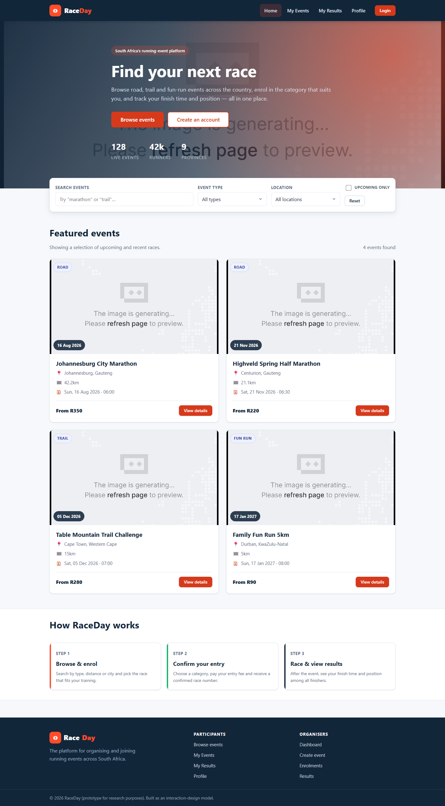
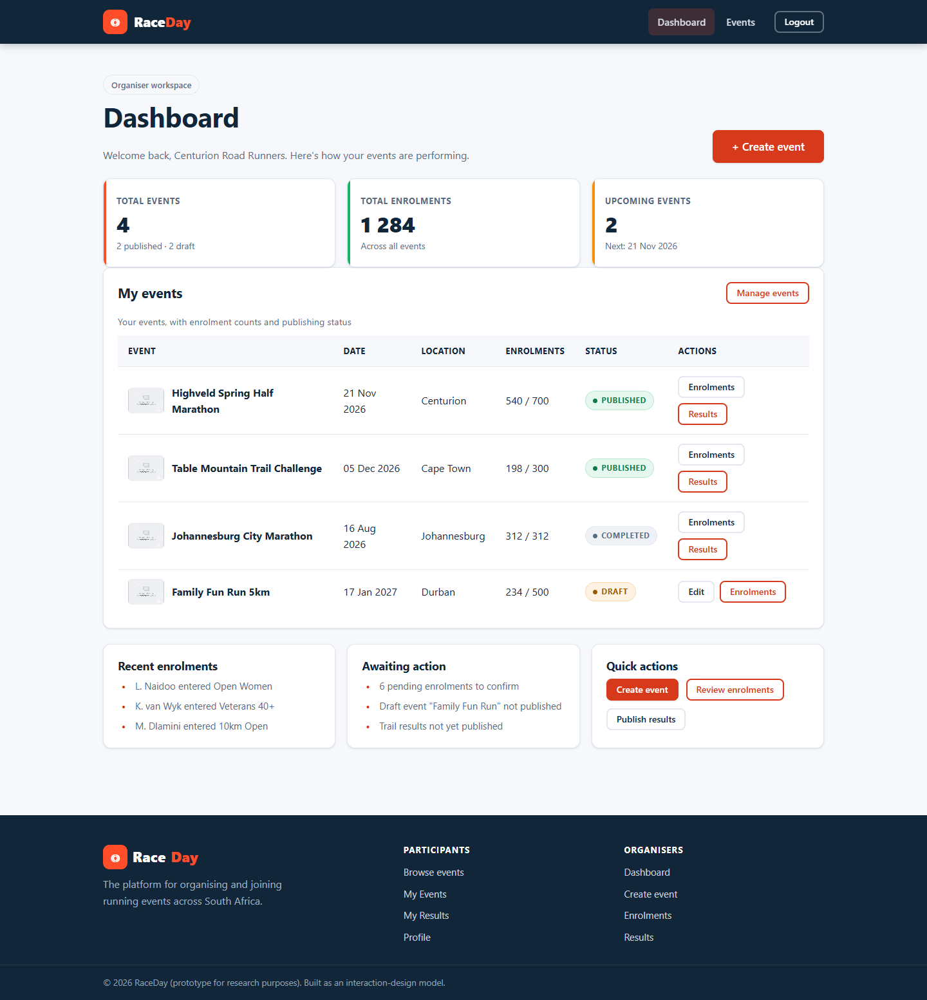
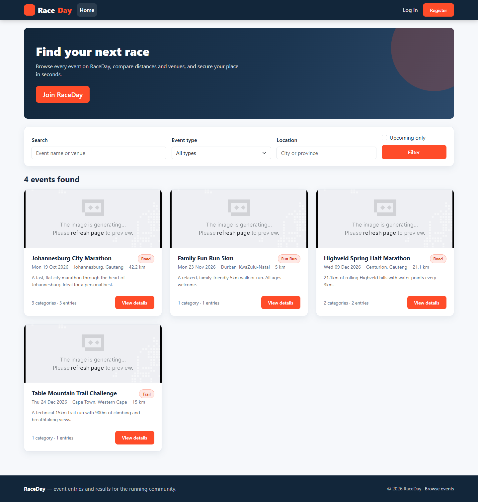
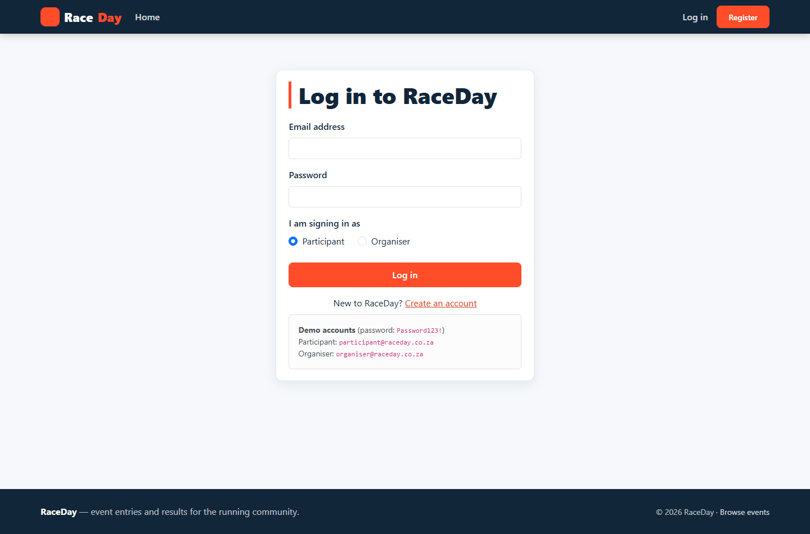
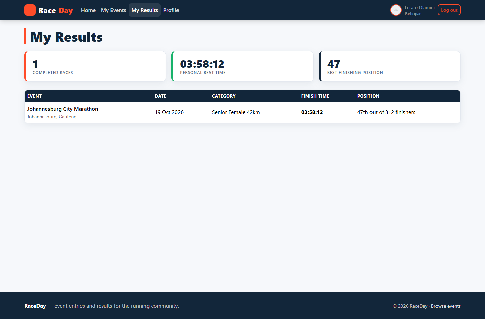
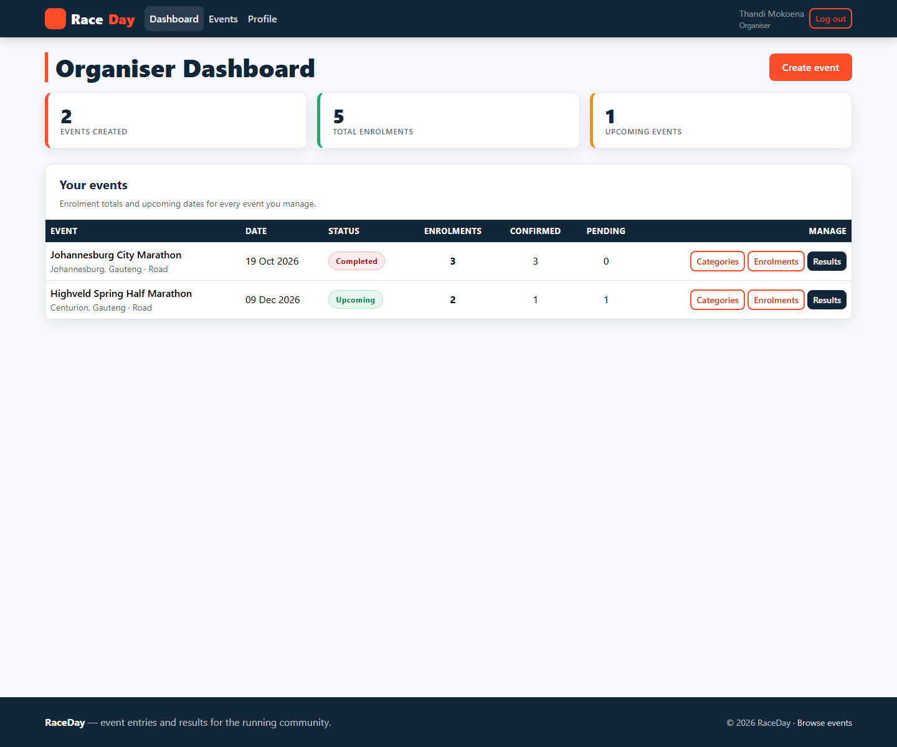
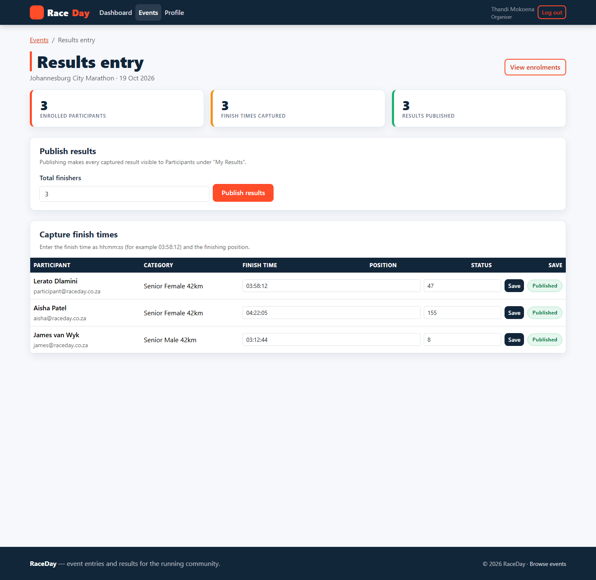

# RaceDay

**RaceDay** is a web platform for discovering and managing running events in South Africa. Participants can browse races, filter by type and location, enrol in a category and view their personal results, while Organisers create events, upload banner images, manage categories, record finish times and publish results. The platform is delivered as an **ASP.NET Core Web API** (with **Entity Framework Core + SQLite**, **JWT bearer authentication** and **Azure Blob Storage** for image uploads) and a separate **ASP.NET Core MVC** front end that talks to the API over HTTP only. The whole stack is containerised with Docker and validated by a GitHub Actions CI pipeline.

`ASP.NET Core 9` · `EF Core 9 + SQLite` · `JWT bearer auth` · `Azure Blob Storage` · `Docker` · `GitHub Actions`

---

## Table of Contents

- [Project Overview](#project-overview)
- [Repository Structure](#repository-structure)
- [Technology Stack](#technology-stack)
- [Architecture](#architecture)
- [Prerequisites](#prerequisites)
- [Running Locally](#running-locally)
- [Running with Docker](#running-with-docker)
- [Azure Blob Storage Configuration](#azure-blob-storage-configuration)
- [Demo Accounts](#demo-accounts)
- [API Endpoint Reference](#api-endpoint-reference)
- [Screenshots](#screenshots)
- [CI/CD](#cicd)
- [YouTube Demonstration Video](#youtube-demonstration-video)
- [Testing the Application](#testing-the-application)
- [Author](#author)
- [References](#references)

---

## Project Overview

This repository contains the complete, three-part Portfolio of Evidence (POE). Part 1 and Part 2 establish the research and the user-interface design; Part 3 delivers the working, automated web application that implements the earlier designs.

| Part | Deliverable | Folder |
| --- | --- | --- |
| **Part 1** | Research report on the chosen domain and problem statement. | `docs/reports/` |
| **Part 2** | Updated research report **plus** a clickable static HTML/CSS/JS prototype of the RaceDay interface. | `Part2-Prototype/` |
| **Part 3 (POE)** | "Automation of Web Application" — the working RaceDay platform: ASP.NET Core Web API + ASP.NET Core MVC front end + Azure Blob Storage + Docker + GitHub Actions CI. | `Part3-RaceDay/` |

---

## Repository Structure

```text
temp_20261109_01/
├── .github/
│   └── workflows/
│       └── ci.yml                 # GitHub Actions CI: restore, build, validate and Docker-build images
├── Part2-Prototype/               # Part 2 deliverable: clickable static HTML/CSS/JS prototype
│   ├── css/
│   │   └── styles.css             # Prototype styling
│   ├── js/
│   │   └── app.js                 # Prototype interactivity (nav, filters, fake state)
│   ├── index.html                 # Prototype entry point (open directly in a browser)
│   ├── event-detail.html          # Event detail screen
│   ├── login.html                 # Login screen
│   ├── register.html              # Registration screen
│   ├── my-events.html             # Participant: my events
│   ├── my-results.html            # Participant: my results
│   ├── profile.html               # Participant: profile
│   ├── organiser-dashboard.html   # Organiser: dashboard
│   ├── organiser-event-form.html  # Organiser: create/edit event
│   ├── organiser-enrolments.html  # Organiser: enrolments
│   └── organiser-results.html     # Organiser: results capture
├── Part3-RaceDay/                 # Part 3 / POE deliverable: the working platform
│   ├── src/
│   │   ├── RaceDay.Api/           # ASP.NET Core 9 Web API (EF Core + SQLite, JWT, Blob Storage)
│   │   │   ├── Controllers/       # Auth, Users, Events, Categories, Enrolments, Results, Organiser
│   │   │   ├── Data/              # DbContext and demo-data seeder
│   │   │   ├── Dtos/              # Request/response DTOs and mapping helpers
│   │   │   ├── Models/            # EF Core entities and enums
│   │   │   ├── Properties/        # launchSettings.json (http://localhost:5132)
│   │   │   ├── Services/          # Token service, file-storage service, options
│   │   │   ├── wwwroot/           # Local-disk upload fallback target
│   │   │   ├── Dockerfile         # Multi-stage build for the API
│   │   │   └── Program.cs         # API composition root (auth, CORS, seeding, /health)
│   │   └── RaceDay.Mvc/           # ASP.NET Core 9 MVC front end (calls the API via ApiClient)
│   │       ├── Controllers/       # Account, Home, Events, MyEvents, MyResults, Profile, Organiser
│   │       ├── Filters/           # RequireLogin filter
│   │       ├── Models/            # DTOs and view models
│   │       ├── Properties/        # launchSettings.json (http://localhost:5031)
│   │       ├── Services/          # Typed ApiClient + session keys
│   │       ├── Views/             # Razor views (Bootstrap 5 layout, role-aware navigation)
│   │       ├── wwwroot/           # CSS, JS and vendored client libraries
│   │       ├── Dockerfile         # Multi-stage build for the MVC app
│   │       └── Program.cs         # MVC composition root (session, ApiClient HttpClient)
│   ├── RaceDay.sln                # Solution containing both projects
│   └── docker-compose.yml         # Runs the API + MVC together with one command
├── docs/
│   ├── reports/                   # Part 1 & Part 2 research reports (generated separately)
│   └── screenshots/
│       ├── app/                   # 18 screenshots of the running MVC application
│       └── prototype/             # 12 screenshots of the Part 2 prototype
└── .gitignore                     # Ignores build output, *.db files, uploads/ and local secrets
```

---

## Technology Stack

| Layer | Technology | Version / Purpose |
| --- | --- | --- |
| Runtime / framework | ASP.NET Core (Web API + MVC) | .NET 9 — hosts the API and the front end |
| Data access | Entity Framework Core + SQLite | EF Core 9.0.0 — ORM over a self-contained `raceday.db` file |
| Authentication | JWT bearer tokens | `Microsoft.AspNetCore.Authentication.JwtBearer` 9.0.0 |
| Password hashing | BCrypt.Net-Next | 4.0.3 — salted BCrypt hashes for user passwords |
| File storage | Azure.Storage.Blobs | 12.22.2 — uploads event banners and profile photos |
| API metadata | Microsoft.AspNetCore.OpenApi | 9.0.21 — OpenAPI document in development |
| Front-end UI | Bootstrap 5 + Razor Views | Responsive, role-aware MVC front end |
| Containerisation | Docker (multi-stage) + Docker Compose | Builds and runs both services together |
| CI/CD | GitHub Actions | Restores, builds, validates the solution and builds both Docker images |

---

## Architecture

RaceDay is deliberately split into two deployable applications with a strict boundary between them:

- **`RaceDay.Mvc` never touches the database.** It has no EF Core reference and no connection string. All data access is performed by a single typed `ApiClient` (`Part3-RaceDay/src/RaceDay.Mvc/Services/ApiClient.cs`) that calls the API over HTTP.
- **The API is the only component with data access.** It owns the EF Core `RaceDayDbContext`, the SQLite database, the JWT issuing logic and the file-storage service.
- **Session-based auth in the MVC app.** On login the MVC app stores the JWT, the user id and the role in server-side session state. The `ApiClient` attaches that token as a `Bearer` header on every outbound call. The session token and DB are the source of truth for role-aware navigation.
- **Uploads are proxied.** When a Participant uploads a profile photo, or an Organiser uploads an event banner, the file is posted to the MVC app, which forwards it to the API (`POST api/users/me/photo` and `POST api/events/{id}/banner`). The API stores it through `IFileStorageService` — in **Azure Blob Storage** when a connection string is configured, or in **local disk** (`wwwroot/uploads`) via the transparent fallback when it is not.
- **The MVC app reaches the API by URL.** Locally this is `ApiBaseUrl` = `http://localhost:5132/`; inside Docker Compose it is set to the API service name `http://raceday-api:8080/`.

```text
        +-------------------+          +---------------------+          +-------------------+
        |      Browser      |  HTTP    |    RaceDay.Mvc      |  HTTP    |    RaceDay.Api    |
        |  (Bootstrap 5 UI) | -------> |  MVC + session      | -------> |  Controllers      |
        |                   |          |  (JWT in session)   |  Bearer  |  JWT auth         |
        +-------------------+          +---------------------+  token   +---------+---------+
                                                    |                             |
                                                    |                    +--------+---------+
                                                    |                    |                  |
                                                    v                    v                  v
                                          (no DB access here)      +-----------+      +-----------+
                                                                   |  SQLite   |      |   Blob    |
                                                                   | raceday.db|      |  Storage  |
                                                                   +-----------+      +-----------+
                                                                                    (or local-disk
                                                                                     wwwroot/uploads
                                                                                     fallback)
```

---

## Prerequisites

| Requirement | Notes |
| --- | --- |
| **.NET 9 SDK** | Required to run the API and MVC app locally. Download from <https://dotnet.microsoft.com/download>. |
| **Git** | Required to clone the repository. |
| **Docker Desktop** | Optional for local development; required to run the Docker workflow. |
| **Azure Storage account** | Optional. Only needed to use real Azure Blob Storage — the app falls back to local disk automatically. |

---

## Running Locally

The API and the MVC app are two separate processes and both must be running.

1. **Run the API** (from the repository root). It listens on **http://localhost:5132**:

   ```bash
   dotnet run --project Part3-RaceDay/src/RaceDay.Api
   ```

2. **Run the MVC app** in a second terminal (from the repository root). It listens on **http://localhost:5031**:

   ```bash
   dotnet run --project Part3-RaceDay/src/RaceDay.Mvc
   ```

3. **Browse to** <http://localhost:5031> and sign in with one of the [demo accounts](#demo-accounts).

> The SQLite database (`raceday.db`) is created and seeded automatically on the first run of the API, so no manual migration or data setup is required. The MVC app is configured by `ApiBaseUrl` in `Part3-RaceDay/src/RaceDay.Mvc/appsettings.json`.

---

## Running with Docker

**This is the single command a marker can use to run the entire platform.** It builds both images and starts the API plus the MVC front end with all wiring in place.

```bash
# From the repository root: enter the project folder that holds docker-compose.yml.
cd Part3-RaceDay

# Build and start the whole platform (API + MVC) in the background.
docker compose up --build
```

Then browse to **http://localhost:5031**.

The Compose file publishes the API on **5132** and the MVC app on **5031**, points the MVC app's `ApiBaseUrl` at the API service (`http://raceday-api:8080/`), and persists the SQLite database and uploads in named volumes (`raceday-api-data`, `raceday-api-uploads`).

### Equivalent plain `docker run` commands

If you prefer to build and run the containers individually:

```bash
# Build the API image (from the repository root).
docker build -t raceday-api:latest Part3-RaceDay/src/RaceDay.Api

# Build the MVC image (from the repository root).
docker build -t raceday-mvc:latest Part3-RaceDay/src/RaceDay.Mvc

# Create a user-defined network so the MVC container can resolve the API by name.
docker network create raceday-net

# Run the API, publishing container port 8080 as host port 5132.
docker run -d --name raceday-api --network raceday-net -p 5132:8080 raceday-api:latest

# Run the MVC front end on host port 5031, pointing ApiBaseUrl at the API container.
docker run -d --name raceday-mvc --network raceday-net -p 5031:8080 -e ApiBaseUrl=http://raceday-api:8080/ raceday-mvc:latest
```

Then browse to **http://localhost:5031**.

---

## Azure Blob Storage Configuration

The API binds the `BlobStorage` configuration section to `BlobStorageOptions`. It reads two values:

| Configuration key | Environment variable | Default | Purpose |
| --- | --- | --- | --- |
| `BlobStorage:ConnectionString` | `BlobStorage__ConnectionString` | `""` (empty) | Azure Storage connection string. |
| `BlobStorage:ContainerName` | `BlobStorage__ContainerName` | `raceday-images` | Blob container that holds uploaded images. |

At start-up the API chooses its storage implementation based on the connection string:

- **Connection string present** → `AzureBlobFileStorageService` is registered. Uploads are written to the configured container, which is created automatically on first use, and the public blob URL is returned.
- **Connection string empty** (the default) → `LocalFileStorageService` is registered. Uploads are written to `wwwroot/uploads/<folder>` and served back from the API itself.

This means **the marker can run the project end-to-end without an Azure account** — uploads simply fall back to local disk. To switch to Azure Blob Storage, supply the connection string, for example:

```bash
# Run the API with real Azure Blob Storage enabled.
docker run --rm -p 5132:8080 \
  -e BlobStorage__ConnectionString="DefaultEndpointsProtocol=https;AccountName=...;AccountKey=...;EndpointSuffix=core.windows.net" \
  -e BlobStorage__ContainerName=raceday-images \
  raceday-api:latest
```

The `docker-compose.yml` wires the same keys from an optional `AZURE_STORAGE_CONNECTION_STRING` environment variable:

```yaml
- BlobStorage__ConnectionString=${AZURE_STORAGE_CONNECTION_STRING:-}
- BlobStorage__ContainerName=raceday-images
```

---

## Demo Accounts

The database is seeded on first run with the following accounts. **The password for every account is `Password123!`.**

| Email | Role | Seeded name |
| --- | --- | --- |
| `organiser@raceday.co.za` | Organiser | Thandi Mokoena |
| `participant@raceday.co.za` | Participant | Lerato Dlamini |
| `sipho@raceday.co.za` | Participant | Sipho Ndlovu |
| `james@raceday.co.za` | Participant | James van Wyk |
| `aisha@raceday.co.za` | Participant | Aisha Patel |

---

## API Endpoint Reference

All routes are relative to the API base URL (`http://localhost:5132/`). "Auth" states the requirement derived from the controller attributes.

### Auth — `api/auth`

| Verb | Route | Auth | Purpose |
| --- | --- | --- | --- |
| `POST` | `api/auth/register` | Anonymous | Registers a new Participant or Organiser and returns a signed JWT. |
| `POST` | `api/auth/login` | Anonymous | Validates credentials and returns a signed JWT plus the user profile. |
| `GET` | `api/auth/me` | Authenticated | Returns the currently authenticated user. |

### Users — `api/users` (all routes require authentication)

| Verb | Route | Auth | Purpose |
| --- | --- | --- | --- |
| `GET` | `api/users/me` | Authenticated | Returns the current user's profile. |
| `PUT` | `api/users/me` | Authenticated | Updates the current user's personal information. |
| `POST` | `api/users/me/photo` | Authenticated | Uploads a profile photo (multipart form) through the storage service. |

### Events — `api/events`

| Verb | Route | Auth | Purpose |
| --- | --- | --- | --- |
| `GET` | `api/events` | Anonymous | Public event list with `search`, `type`, `location` and `upcoming` filters. |
| `GET` | `api/events/mine` | Organiser | Events belonging to the signed-in Organiser. |
| `GET` | `api/events/{id}` | Anonymous | Full detail for a single event, including its categories. |
| `POST` | `api/events` | Organiser | Creates a new event owned by the signed-in Organiser. |
| `PUT` | `api/events/{id}` | Organiser | Updates an event (own events only). |
| `DELETE` | `api/events/{id}` | Organiser | Deletes an event (own events only). |
| `POST` | `api/events/{id}/banner` | Organiser | Uploads an event banner image through the storage service. |

### Categories

| Verb | Route | Auth | Purpose |
| --- | --- | --- | --- |
| `GET` | `api/events/{eventId}/categories` | Anonymous | Lists the categories available for an event. |
| `POST` | `api/events/{eventId}/categories` | Organiser | Creates a category on one of the Organiser's events. |
| `PUT` | `api/categories/{id}` | Organiser | Updates a category (own events only). |
| `DELETE` | `api/categories/{id}` | Organiser | Deletes a category (own events only). |

### Enrolments

| Verb | Route | Auth | Purpose |
| --- | --- | --- | --- |
| `POST` | `api/events/{eventId}/enrolments` | Participant | Enrols the signed-in Participant, optionally selecting a category. |
| `GET` | `api/enrolments/mine` | Participant | All enrolments belonging to the signed-in Participant. |
| `DELETE` | `api/enrolments/{id}` | Participant | Cancels one of the Participant's own enrolments. |
| `GET` | `api/events/{eventId}/enrolments` | Organiser | All enrolments for one of the Organiser's events, with category and status. |

### Results

| Verb | Route | Auth | Purpose |
| --- | --- | --- | --- |
| `POST` | `api/events/{eventId}/results` | Organiser | Captures (or updates) a Participant's finish time and position. |
| `POST` | `api/events/{eventId}/results/publish` | Organiser | Publishes all captured results for an event, making them visible to Participants. |
| `GET` | `api/participants/me/results` | Participant | The signed-in Participant's personal history (published results only). |

### Organiser — `api/organiser`

| Verb | Route | Auth | Purpose |
| --- | --- | --- | --- |
| `GET` | `api/organiser/dashboard` | Organiser | Summary of the Organiser's events, enrolments and per-event breakdown. |

### Health / meta

| Verb | Route | Auth | Purpose |
| --- | --- | --- | --- |
| `GET` | `/` | Anonymous | API banner: name, status and active storage backend. |
| `GET` | `/health` | Anonymous | Liveness probe returning `{ "status": "healthy" }`. |

---

## Screenshots

**Part 2 — static prototype**





**Part 3 — running MVC application**











---

## CI/CD

The GitHub Actions workflow in `.github/workflows/ci.yml` runs on every push and pull request (and can be triggered manually). It consists of two jobs:

1. **Build .NET solution** — checks out the repository, installs the .NET 9 SDK, restores `Part3-RaceDay/RaceDay.sln`, builds it in `Release` configuration, validates the required repository files (both `.csproj` files, both `Dockerfile`s, `docker-compose.yml`, `README.md` and `Part2-Prototype/index.html`) are present, and publishes both projects.
2. **Build Docker images** — builds the API image and the MVC image from the committed multi-stage `Dockerfile`s, proving that both containers build cleanly.

The workflow must show a **green build** on the repository's Actions tab.

> **CI status screenshot:** add your green GitHub Actions run screenshot at `docs/screenshots/ci-green-build.png` and paste it here before submitting.

---

## YouTube Demonstration Video

**Video link:** <PASTE UNLISTED YOUTUBE LINK HERE>

The unlisted demonstration video must show:

- The **MVC application pages for each role** — guest browsing, Participant navigation and Organiser navigation.
- The **Azure Blob Storage upload flow** — uploading an event banner and/or a profile photo and showing the returned image URL.
- **Docker** — building and starting the platform (`docker compose up --build`) and browsing to <http://localhost:5031>.
- The **CI pipeline** — the green GitHub Actions workflow run.

---

## Testing the Application

A manual checklist for verifying the main flows:

- [ ] **Register** a new account from the registration page and confirm you are signed in.
- [ ] **Log in** with a demo account and confirm the session is established.
- [ ] **Role-aware menus** — sign in as a Participant and as an Organiser and confirm the navigation differs.
- [ ] **Enrol** a Participant in an open event and confirm it appears under *My Events*.
- [ ] **Organiser creates an event and uploads a banner** — create an event, upload a banner image and confirm it is displayed.
- [ ] **Results entry** — as an Organiser, record a finish time and position, then publish the results.
- [ ] **Participant views published results** on the *My Results* page.
- [ ] **Log out** and confirm the session is cleared.
- [ ] **Unauthenticated redirect** — request a protected page while signed out and confirm you are redirected to the login page.

---

## Author

| Field | Value |
| --- | --- |
| Name | [Your Full Name] |
| Student number | [Your Student Number] |
| Module | [Module Code] |

---

## References

Microsoft (2024) *ASP.NET Core documentation*. Available at: https://learn.microsoft.com/aspnet/core (Accessed: 2026).

Preece, J., Sharp, H. & Rogers, Y. (2015) *Interaction Design: Beyond Human-Computer Interaction*. 4th ed. Chichester: Wiley.

W3C (2008) *Web Content Accessibility Guidelines (WCAG) 2.0*. Available at: https://www.w3.org/TR/WCAG20/ (Accessed: 2026).
